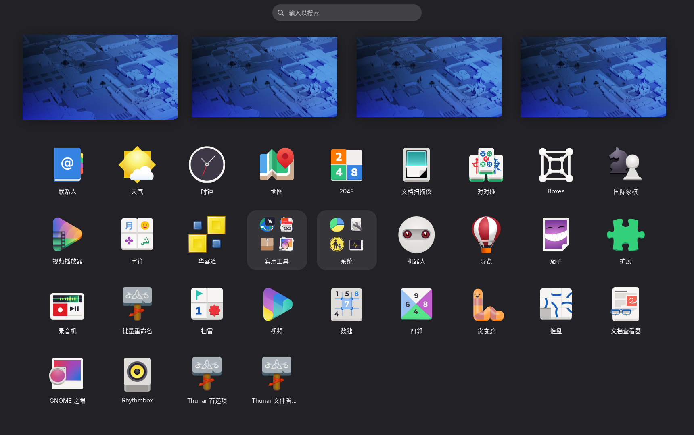
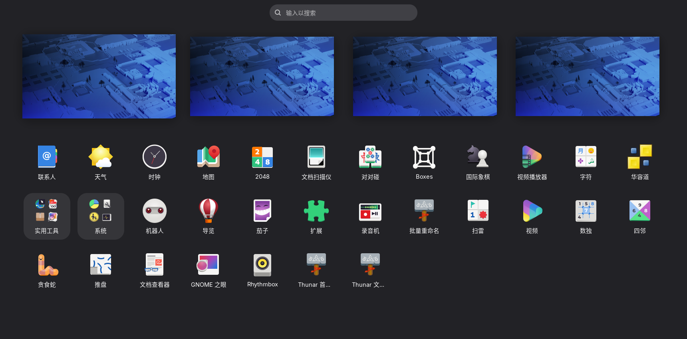
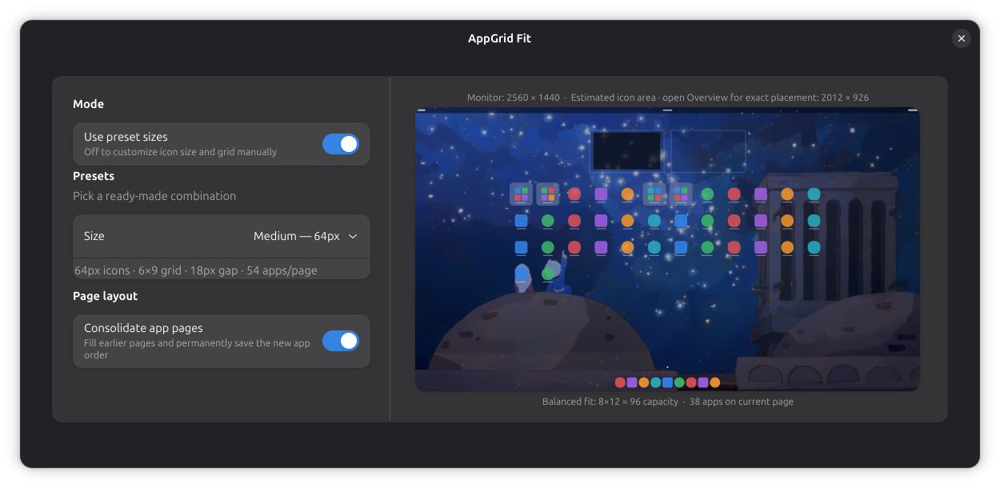
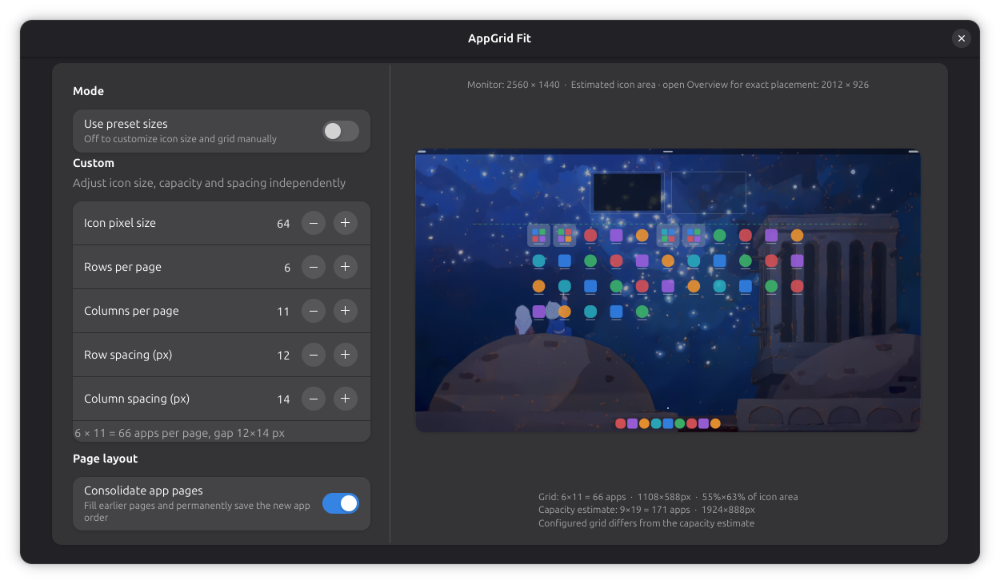

# AppGrid Fit

A GNOME Shell extension (46–51) that lets you customize the App Grid layout — icon size, rows/columns per page, and spacing — so you can fit more apps on each page.

Current version: **1.3.4**

## Features

- **4 preset levels**: Large (96px), Medium (64px), Small (48px), Tiny (32px)
- **Balanced fit**: Presets calculate rows/columns from your screen and Shell's full app-tile size while using 80% of the available width for a centered layout
- **Custom mode**: Fine-tune icon size, rows, columns, row/column spacing independently
- **Configurable folder dialogs**: Choose the folder dialog's icon size, rows, columns and gaps, with a dedicated preview in the preferences window; child icons, labels and spacing follow the same settings, the dialog always keeps the configured grid area (a 3×3 folder shows 3×3 even with fewer apps), and the panel fits that grid with balanced 24 px side margins while keeping the folder name and edit button inside and centered
- **Show or hide application names**: Toggles labels under apps and folders in both the App Grid and folder dialogs, and the preview reflects the choice
- **Layout snapshots**: Save the current grid, app order, folder contents and visibility settings as a named snapshot, keep up to 20, and restore any of them after confirming the replacement
- **Optional page consolidation**: Fills pages to capacity and saves the resulting app order only when explicitly enabled
- **Persistent app order**: Keeps drag-and-drop positions stable across login even when a page contains more than Shell's default 24 apps
- **Order-preserving reflow**: Shrinking the grid rebuilds overflow pages in their original order instead of letting Shell move items to the front of the next page
- **Responsive layout**: Recalculates preset capacity when the overview allocation or monitor configuration changes
- **Live settings**: Preference changes apply immediately after the extension has been loaded
- **Theme-aware restoration**: Spacing and CSS limits are re-read after theme changes and restored exactly when the extension is disabled
- **Ubuntu-aware preview**: Uses the measured page indicators and dock position on Ubuntu's adaptive layout instead of assuming a centered horizontal Dash
- **Small-screen friendly preferences**: Controls scroll when needed, the window sizes to the monitor, and a Fit button suggests the largest grid that fits

## Screenshots

**App Grid — Large Icons**



**App Grid — Medium**



**Preferences — Preset Mode**



**Preferences — Custom Mode**



## Presets

Presets use balanced fitting — the rows/columns below are base recommendations, while the actual grid is calculated from the current allocation at runtime. Balanced fitting uses 80% of the available icon-area width, leaving roughly 10% breathing room on each side without wasting a large central workspace.

| Level | Icon Size | Base Grid | Gap |
|-------|-----------|-----------|-----|
| Large | 96 px | 4×6 | 24 px |
| Medium | 64 px | 6×9 | 18 px |
| Small | 48 px | 8×12 | 14 px |
| Tiny | 32 px | 12×16 | 10 px |

## Installation

```bash
# Compile schema
glib-compile-schemas schemas/

# Package
gnome-extensions pack --force \
  --extra-source=config.js \
  --extra-source=gridPages.js \
  --extra-source=gridLayout.js \
  --extra-source=snapshots.js \
  --extra-source=LICENSE \
  "$(pwd)"

# Install
gnome-extensions install --force appgrid-size@luyao.shell-extension.zip

# Reload GNOME Shell (required for first install or schema changes)
# Xorg: press Alt+F2, type "r", press Enter
# Wayland: log out and log back in

# Enable
gnome-extensions enable appgrid-size@luyao
```

## Usage

Open the extension preferences via:

- **Extensions** app → AppGrid Fit → Settings
- Or run: `gnome-extensions prefs appgrid-size@luyao`

Switch between presets or disable **Use preset sizes** for granular control. Custom values are independent: changing the icon size does not overwrite the configured rows, columns, or spacing. Folder dialogs have their own rows, columns and gap controls, and **Layout snapshots** stores the whole arrangement — including `app-picker-layout` and folder membership — for later restoration.

**Consolidate app pages** is disabled by default. Enabling it fills earlier pages and permanently saves the resulting application order.

The preferences window uses a horizontal layout with scrollable controls on the left and a large monitor preview on the right. While the extension is active, the preview uses measured App Grid tiles, icons, per-page item counts, page indicators, dock visibility and position, search entry, workspace thumbnails, and Dash geometry from GNOME Shell instead of relying solely on a generic monitor estimate. Before live geometry is available, it reads Shell's top-level app-picker layout and folder IDs so folders and page boundaries still produce the correct visible icons. Preview colors are varied deterministically from each application or folder ID, avoiding row or column color bands without flickering between redraws. Folder detection follows system settings automatically and is not tied to fixed positions. Open the overview once after changing the layout to publish settled positions. The window defaults to a monitor-aware size within 760–1200 × 420–560, and the controls pane scrolls on smaller displays. When a custom grid exceeds the estimated screen capacity, the preview reports the mismatch and offers a Fit button that applies the suggested rows and columns.

## Requirements

- GNOME Shell 46, 47, 48, 49, or 50
- Supports both upstream grid modes and Ubuntu 26.04's adaptive App Grid layout.

## License

MIT

## Changelog

See [CHANGELOG.md](CHANGELOG.md) for release details.

## Development checks

```bash
npm run check
glib-compile-schemas --strict --dry-run schemas/
```

CI additionally builds the final ZIP, verifies its GNOME metadata, schema declaration,
local imports, review-sensitive APIs, archive paths and contents, runs Shexli, and uploads
the validated package as a workflow artifact.

## Automated compatibility verification

`scripts/verify-qemu.sh` runs the compatibility probe in disposable QEMU guests, so the
machine you use is never the test target:

```bash
scripts/verify-qemu.sh                        # all cases
scripts/verify-qemu.sh --case ubuntu-26.04
scripts/verify-qemu.sh --rebuild-golden --case fedora-44
```

| Case | GNOME layout |
| --- | --- |
| `ubuntu-24.04` | upstream mode-based `IconGridLayout` |
| `ubuntu-26.04` | Ubuntu adaptive `IconGridLayout` |
| `fedora-44` | upstream mode-based `IconGridLayout` |
| `fedora-51` | upstream GNOME Shell 51 (rawhide) |

The `fedora-51` case uses Fedora's upstream rawhide image and downloads rawhide packages
from the NJU mirror because Tsinghua does not carry rawhide; every other case stays pinned
to Tsinghua.

The first run downloads each cloud image from the Tsinghua mirror (upstream Fedora for
`fedora-51`) and provisions a golden image once (GNOME Shell, test user, dummy app grid). Later runs boot a throwaway qcow2
overlay backed by that golden image and delete it afterwards, so the guest desktop, extension
settings and app order always start clean. The cache lives under
`${XDG_CACHE_HOME:-~/.cache}/appgrid-qemu` (`images/`, `golden/`, `keys/`, `runs/`, `logs/`).
Guest package installation is also pinned to a Chinese mirror: Ubuntu's apt primary and
security URIs are replaced before `package_update`, Fedora's release and update repositories
drop their metalinks for Tsinghua base URLs, and provisioning fails if any active source
still points elsewhere. `fedora-51` pins rawhide repositories to the NJU mirror instead.

Host requirements: x86_64 Linux, `qemu-system-x86_64`, `qemu-img`, `ssh`, `scp`,
`ssh-keygen`, `curl`, `python3`, `timeout`, and one of `cloud-localds`, `genisoimage`,
`mkisofs` or `xorriso`. KVM is used when available; otherwise QEMU falls back to TCG, which
is much slower. The guest uses a 1920×1080 virtual monitor by default; set `MONITOR=WxH` to
override it. Each run writes its serial log and probe output to
`<cache>/logs/<timestamp>-<case>/`. Acceptance is the probe exit status. Use
`--keep-overlay` to keep the throwaway disk for debugging.

The guest Shell runs `--headless --wayland --no-x11 --unsafe-mode` under an isolated D-Bus
and XDG session. `--no-x11` avoids a GVC/Xwayland startup deadlock when no display is
available, and the isolated session keeps dconf, extension settings and app order out of the
live desktop.

The older live-session harnesses remain available for manual debugging but are not part of
the default acceptance path:

```bash
scripts/verify-ubuntu-vm.sh      # VirtualBox/GDM VM
scripts/verify-fedora-headless.sh
```

See [docs/ubuntu-26.04-verification.md](docs/ubuntu-26.04-verification.md) for the covered
checks and environment details.
